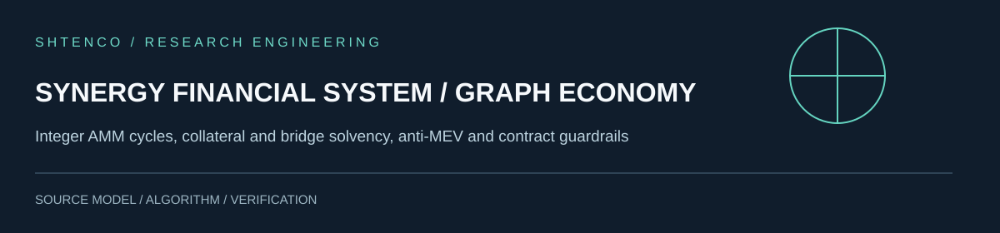

# SYNERGY FINANCIAL SYSTEM / GRAPH ECONOMY

**Integer AMM cycles, collateral and bridge solvency, anti-MEV and contract guardrails.**

## Research proposition and implemented work

The architecture includes Solidity contracts for settlement-sensitive liquidity actions, treasury and anti-MEV control surfaces, a deterministic integer CPMM graph enumerator, USDT settlement with flash fees and transfer taxes, and a dual-circuit model distinguishing real Polygon POL reserves from internal synthetic balances.

## Mathematical and scientific interpretation

With token reserves x, y, fee f and positive input a, ideal non-rounded CPMM output is x*a*(1-f)/(y+a*(1-f)). An opportunity is positive only when USDT output exceeds principal, flash premium, gas and all real external costs. A token repricing does not create redeemable external LNAV.

## High-value engineering roadmap

Repeat deterministic fixtures and token-tax counterfactuals, test external asset conservation, verify fee-on-transfer behavior and require archive-block Polygon fork tests before authorized deployment.

## Architecture / implementation provenance

- [`simulation/graph_arbitrage.py`](simulation/graph_arbitrage.py)
- [`simulation/dual_circuit_solvency.py`](simulation/dual_circuit_solvency.py)
- [`contracts/LiquidityGrowthCycle.sol`](contracts/LiquidityGrowthCycle.sol)
- [`docs/GRAPH_ARBITRAGE_QE_RESULTS.md`](docs/GRAPH_ARBITRAGE_QE_RESULTS.md)

## Evidence and product framing

This project belongs to the SHTENCO engineering research portfolio. Its distinguishing mechanisms can underpin future applied systems, but the status of each claim is limited to the source and observed evidence. Deployment and financial effectiveness require independent repeatable evidence. No model outcome, status or yield is invented here.

**Research reading rule:** do not substitute explanatory diagrams for actual deployments; preserve repository-specific source files and build artifacts for independent verification.
