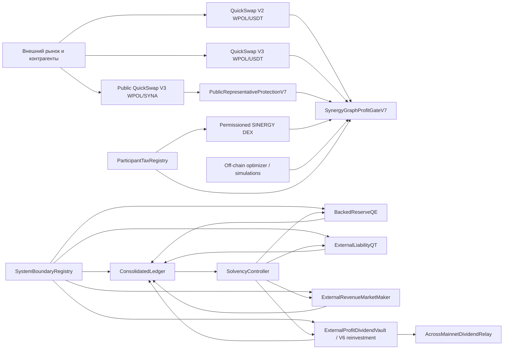

# SYNERGY / SINERGY DEX — полная документация системы

> Статус документа: архитектурное руководство, экономическая спецификация и карта текущей реализации.
>
> Репозиторий: `Shtenco/ai_financial_system`
>
> Проверенная кодовая база: ветка `audit/synergy-qe-polygon-fork`, PR #7, baseline commit `90273f12d356411af70bae0ba64265b7a83455cc`.
>
> Состояние системы: экспериментальная архитектура и успешно протестированный прототип. Не production-ready. Не является обещанием доходности, инвестиционной рекомендацией или подтверждением юридического соответствия какой-либо юрисдикции.

---

## 1. Что такое SYNERGY

SYNERGY — это проект автономной цифровой экономики, в которой токены, резервы, биржевая ликвидность, арбитраж, QE, QT, дивиденды, мосты и операционные расходы рассматриваются как единый консолидированный баланс.

Главная задача системы — не создать ещё один токен и не показать рост цены внутри замкнутого рынка. Главная задача — построить финансовое ядро, способное отличать реальное внешнее увеличение стоимости от внутреннего перемещения собственных активов.

В простом образе SYNERGY — это закрытый финансовый город:

- внутри находятся собственная permissioned-биржа, казна, резервные контуры, учёт и контроллеры;
- снаружи находятся QuickSwap, внешние контрагенты, мосты, публичная ликвидность и рыночный риск;
- внутренние дороги нужны для управления системой;
- внешние ворота нужны для получения и фиксации реальной стоимости;
- бухгалтер не разрешает назвать прибылью деньги, переложенные между двумя адресами одного и того же протокола.

Ключевой результат всей разработки сформулирован следующим образом:

> Внутренний оборот не является внешней прибылью. Эмиссия не является доходом. Изменение внутренней цены не является ростом консолидированного NAV. Сжигать и распределять можно только стоимость, которую система действительно получила, сохранила и доказала после всех затрат и обязательств.

---

## 2. Экономическая конституция

Ни один модуль не должен обходить следующие принципы.

### 2.1. Внешняя прибыль

Внешняя прибыль существует только тогда, когда одновременно выполнены условия:

1. актив поступил от адреса за пределами консолидированной системной границы либо был получен в результате доказанного внешнего торгового цикла;
2. поступление подтверждено фактическим изменением баланса резервного актива;
3. из результата вычтены комиссии пулов, газ, проскальзывание, flash-loan premium, выплаты keeper, bridge fee, oracle/risk haircut и потеря стоимости protocol-owned liquidity;
4. операция не создаёт неучтённого внешнего обязательства;
5. итоговый консолидированный NAV после операции не хуже допустимого предоперационного уровня;
6. источник результата не использован повторно.

### 2.2. Что не является прибылью

Не признаются внешней прибылью:

- перевод между двумя системными адресами;
- mint SYNA, SYNR, SYN, SYNT или другого внутреннего инструмента;
- создание внутренней пары с эмитированным токеном;
- рост spot price в protocol-owned pool;
- рост market capitalization без реализуемого внешнего резерва;
- перенос средств из казны в маркет-мейкер, keeper, мост или дочерний контракт;
- внутренний wash trade;
- flash-loan principal;
- возвращённый ранее собственный капитал;
- сжигание protocol inventory;
- controlled mark на другой сети;
- выпуск synthetic liability без внешнего обеспечения;
- QE notional;
- прибыль одного системного адреса, компенсированная большей потерей другого системного адреса.

### 2.3. Балансовая идентичность

Консолидированная логика системы исходит из равенства:

```text
Consolidated NAV = realizable haircut assets - stress liabilities
```

Внешний капитал, сопровождающийся выпуском обязательства, не увеличивает PnL. Он одновременно увеличивает активы и обязательства.

Прибыль признаётся только в части, которая остаётся после покрытия нового обязательства и внешних затрат.

### 2.4. Неподлежащие обходу ограничения

Система не должна:

- платить дивиденды из principal, bridge reserve или flash liquidity;
- использовать внутреннюю переоценку как обеспечение внешнего погашения;
- продолжать выполнение при отрицательном expected external net value;
- продолжать выполнение при stale oracle, недоступном мосте или недостаточном газовом резерве;
- использовать QE как замаскированный buyback, operations budget или dividend channel;
- признавать protocol-owned keeper внешним плательщиком;
- скрывать FAIL, skipped action, gas drain, negative PnL или insolvency state;
- заявлять гарантированный рост или абсолютную MEV-защиту.

---

## 3. Концептуальные активы

В истории проекта используются следующие экономические роли.

| Актив | Роль | Текущий смысл |
|---|---|---|
| `SYNA` | токен роста и публичный представитель | в V7 отдельный representative token, связанный с публичным WPOL/SYNA-контуром и внутренними разрешёнными endpoint |
| `SYNR` | резервный токен | в V7 внутренний reserve token, ограниченный системными endpoint |
| `SYNT` | расчётная единица | концептуальная единица для платежей, комиссий и вознаграждений; не является центральным активом V7 graph fork-test |
| `SYN` | обобщённое внешнее обязательство в QT/solvency-модулях | используется в отдельных V2/V3/V4 recovery-сценариях; не следует автоматически отождествлять с конкретным V7 representative token |
| `WPOL` | внешний резервный и settlement asset Polygon | реальный внешний актив, основной капитал и один из разрешённых settlement assets |
| `USDT` | внешний долларовый settlement asset | используется для внешних выходов, долларового учёта и внутреннего полного графа V7 |

Важно: репозиторий содержит несколько исследовательских поколений контрактов. Одинаковые экономические слова в V2, V3, V4, V5, V6 и V7 не всегда означают один и тот же deployed asset или один и тот же production-контур. Перед развёртыванием требуется отдельный deployment manifest с точным сопоставлением `роль → контракт → chain → address → decimals → owner → upgradeability`.

---

## 4. Область системы и граница консолидации

`SystemBoundaryRegistry` определяет адреса, принадлежащие консолидированной системе.

Если оба адреса зарегистрированы как system address, перевод между ними является внутренним. Он может изменять ликвидность отдельного модуля, но не должен изменять консолидированный внешний PnL или NAV.

Типичные системные адреса:

- treasury;
- reserve vault;
- QE allocator;
- QT controller;
- protocol-owned market maker;
- dividend vault до момента внешней выплаты;
- bridge adapter до момента окончательного внешнего settlement;
- internal DEX router и protocol-owned pools;
- keeper, если он является protocol-owned операционным адресом;
- insurance и gas reserve;
- контроллеры и расчётные escrow.

Типичные внешние контрагенты:

- независимый покупатель;
- независимый solver;
- внешний LP или трейдер;
- публичный DEX pool, не принадлежащий протоколу;
- поставщик bridge/yield услуги;
- получатель настоящего дивиденда;
- поставщик газа или keeper, если он действительно независим и получает возмещение за фактическую внешнюю услугу.

Граница является экономической, а не только технической. Адрес нельзя считать внешним только потому, что он не внесён в mapping. Процедура governance обязана поддерживать registry в соответствии с фактическим контролем, связанностью, бенефициарами и источником средств.

---

## 5. Общая архитектура



Архитектура разделяется на семь уровней:

1. **Asset layer** — WPOL, USDT и токены SYNERGY.
2. **Boundary and identity layer** — системная граница и eligibility/attestation участников.
3. **Accounting layer** — append-only ledger, классификация поступлений, обязательств, расходов, потерь и дивидендов.
4. **Risk and solvency layer** — haircut assets, stress liabilities, liquidity coverage, gas coverage, reserve-policy ratio и режимы работы.
5. **Execution layer** — internal DEX, graph gate, QE, QT, market maker, dividend, bridge и flash adapters.
6. **Protection layer** — allowlist, code existence, pool topology, deadlines, minOut, commit/reveal, oracle deviation и post-trade checks.
7. **Evidence layer** — unit tests, Polygon fork tests, deterministic simulation, Monte Carlo, stress matrices, validators и GitHub Actions artifacts.

---

## 6. Репозиторий

Основные каталоги:

```text
contracts/          Solidity-контракты системы
contracts/accounting/
contracts/bridge/
contracts/dividend/
contracts/fork/
contracts/graph/
contracts/liquidity/
contracts/mm/
contracts/policy/
contracts/qe/
contracts/qt/
contracts/test/

simulation/         Детерминированные и Monte Carlo экономические модели
scripts/            Валидаторы, вспомогательные скрипты, визуализация и preflight

test/               Hardhat unit и Polygon fork tests
.github/workflows/  Автоматические acceptance gates

docs/               Архитектурные, экономические и security-документы
reports/            Генерируемые доказательства; обычно создаются CI и не являются source code
```

Технологический стек проверенной ветки:

- Solidity `0.8.26`;
- optimizer `500` runs;
- `viaIR: true`;
- EVM target `paris`;
- Hardhat `2.22.19`;
- ethers `6.17.0`;
- OpenZeppelin Contracts `5.6.1`;
- Python `3.12` в CI;
- NumPy для симуляций;
- Anvil для pinned Polygon fork;
- Node.js 20 заявлен workflow, однако GitHub Actions уже предупреждает о его deprecation и фактически переводит actions runtime на Node 24.

---

## 7. История развития

### 7.1. Ранний growth-cycle

Первоначальная архитектура исследовала LP removal, buyback, mint и re-add liquidity. Детерминированная модель показала, что уничтожение LP не освобождает стоимость: оно уничтожает требование казны на ликвидность. Buyback и повторное добавление ликвидности переставляют существующие активы, но не создают внешний LNAV.

Из этого возникло первое фундаментальное правило: sustainable growth требует независимого внешнего источника — торговых комиссий внешних участников, прибыльного арбитража, external yield или добровольной solver revenue.

### 7.2. Graph arbitrage и transfer-tax эксперименты

Были исследованы многотокенные графы с WPOL, USDT, USDS и другими активами. Модель показала, что высокий transfer tax может полностью уничтожить маршрут, который выглядит прибыльным при предположении ordinary ERC-20.

Поэтому on-chain и off-chain модели обязаны учитывать реальные balance deltas, fee-on-transfer поведение, DEX fee, flash premium и gas.

### 7.3. Anti-MEV и orderflow

Проект отказался от обещания «железной» защиты, потому что прозрачный публичный mempool не позволяет контракту определить любого MEV-бота или отменить законную внешнюю транзакцию.

Вместо невозможного обещания были приняты объективно проверяемые меры: commit/reveal, добровольный bond, expiry slashing, allowlisted targets, minOut, deadline, oracle bounds, post-trade profit check и рекомендация private order flow/batch auction.

### 7.4. Dual-circuit solvency

Исследование двухконтурной системы доказало, что controlled L1 price не является externally redeemable asset. Повышение внутренней отметки на 300–400% не добавляет POL в Polygon wallet или bridge reserve.

Bridge может вернуть только ранее escrowed актив либо стоимость, поступившую из явно определённого внешнего источника.

### 7.5. Consolidated Solvency V3

Появились единая системная граница, консолидированный ledger, haircut-оценка активов, stress liabilities, безопасные режимы, external-only revenue, external liability QT и dividend gate.

### 7.6. Real Liquidity Multiplier V4

Система перешла от номинального роста к проверке реальной ликвидности. Множитель признаётся только вместе с резервным, liquidity, gas и stress-инвариантами.

### 7.7. V5: permissioned DEX и compounding

V5 добавила:

- `ParticipantTaxRegistry` как on-chain attestation gate;
- permissioned constant-product SINERGY DEX;
- representative tokens с ограниченными endpoint;
- разделение original capital и reinvested profit;
- автоматическое реинвестирование net dividend вместо cash leakage;
- strict external payer requirement.

### 7.8. V6: self-support без нового капитала

V6 добавила bounded keeper reimbursement до расчёта net external profit и скалярный self-support invariant.

Hard gates V6 требуют:

- неизменность bootstrap original capital;
- отсутствие cash dividend;
- отсутствие internal transfer revenue;
- multiplier не ниже 3×;
- risk invariant не ниже 1.0;
- полное покрытие фактического keeper gas;
- идентичность ожидаемого и фактического реинвестирования.

### 7.9. V7: полный внутренний граф и публичный representative edge

V7 объединила внутреннюю permissioned-экономику и ограниченный внешний контур.

Фактическая topology V7:

```text
Internal SINERGY DEX — 6 pools
WPOL/SYNA
WPOL/SYNR
SYNA/SYNR
WPOL/USDT
USDT/SYNA
USDT/SYNR

Public representative — 1 pool
QuickSwap V3 WPOL/SYNA

External exits — 2 pools
QuickSwap V2 WPOL/USDT
QuickSwap V3 WPOL/USDT

Total graph: 9 pools
```

Это полный неориентированный граф над четырьмя внутренними активами `WPOL`, `USDT`, `SYNA`, `SYNR` плюс три внешние рыночные связи.

---

## 8. ParticipantTaxRegistry

`ParticipantTaxRegistry` является execution permission registry.

Он хранит:

- флаг регистрации;
- срок действия tax-compliance attestation;
- hash внешней tax identity;
- список attester.

`isEligible()` возвращает true только для зарегистрированного участника с неистёкшим сроком attestation.

Ограничение: контракт не определяет налоговое резидентство, налоговую ставку, KYC/AML-статус или юридическую ответственность. Он лишь исполняет attestation, предоставленную уполномоченным attester. Юридический и compliance-процесс должен существовать вне блокчейна, иметь политику доказательств, сроки пересмотра и процедуру отзыва.

---

## 9. ConsolidatedLedger

`ConsolidatedLedger` — центральный бухгалтерский журнал.

Он использует классификации:

- `INTERNAL_TRANSFER`;
- `EXTERNAL_REVENUE`;
- `EXTERNAL_EXPENSE`;
- `CAPITAL_INFLOW`;
- `CAPITAL_OUTFLOW`;
- `LIABILITY_ISSUANCE`;
- `LIABILITY_REDEMPTION`;
- `INVENTORY_TRANSFER`;
- `REALIZED_TRADING_PNL`;
- `UNREALIZED_REVALUATION`;
- `RESERVE_RECLASSIFICATION`;
- `DIVIDEND`;
- `LOSS`.

Полные записи публикуются событиями и включаются в append-only hash chain `ledgerRoot`. `sourceId` одноразовый и не может быть зарегистрирован повторно.

Основные агрегаты:

- `internalTransferVolume`;
- `cumulativeExternalRevenue`;
- `cumulativeExternalExpense`;
- `externalLiabilities`;
- `protocolInventory`;
- `totalDividends`;
- `realizedLosses`;
- `realizedExternalPnL`;
- `consolidatedNavDelta`.

External revenue требует:

- внешний payer;
- системный receiver;
- ненулевую сумму;
- фактический balance delta;
- вычет external costs.

Capital inflow с liability увеличивает `externalLiabilities`, но не PnL.

Discounted liability redemption уменьшает обязательство и признаёт только разницу между stress liability и cash payment.

Сжигание protocol inventory не уменьшает внешнее обязательство и не создаёт PnL.

---

## 10. SolvencyController

`SolvencyController` оценивает не market cap, а реализуемые активы после haircut.

### 10.1. Активы

- liquid reserves — 100%;
- stable LP NAV — haircut 85%;
- volatile LP NAV — haircut 65%;
- bridge capital — haircut 70%;
- insurance assets — haircut 90%;
- yield positions — haircut 80%;
- unrealized inventory — haircut 25%;
- gas reserve — 100%.

### 10.2. Stress liabilities

- ledger external liabilities;
- external SYNR claims;
- vested MEV claims;
- bridge obligations;
- keeper reimbursements accrued;
- external debt;
- expected 30-day operating costs;
- modeled redemption shock.

### 10.3. Основные коэффициенты

```text
economicSolvencyBps = haircutAssets / stressLiabilities
liquidityCoverageBps = immediatelyAvailableLiquidAssets / stressedThirtyDayOutflows
gasCoverageBps = (reimbursedGas + gasReserve) / reimbursedGas
reservePolicyRatioBps = reservePolicyCapital / conservativeTokenObligations
```

Основные пороги текущего контракта:

- normal solvency: 120%;
- defensive solvency: 105%;
- normal liquidity coverage: 120%;
- gas coverage: 120%;
- minimum reserve-policy ratio: 70%.

### 10.4. Режимы

- `BOOTSTRAP`;
- `RECOVERY`;
- `NORMAL`;
- `DEFENSIVE`;
- `PAUSED`;
- `DIVIDEND`;
- `EMERGENCY`.

`canExecute()` разрешает операцию только в `NORMAL` или `RECOVERY`, при свежем oracle, доступном bridge, наличии external opportunity и положительном expected external net value после minimum margin.

`dividendableCapital()` ограничивается одновременно:

- ledger-proven realized external PnL;
- уже выплаченными дивидендами;
- положительным consolidated NAV;
- liquidity, gas, insurance и operating buffers.

---

## 11. QE

В текущем консолидированном контуре `BackedReserveQE` не печатает активы и не проводит buyback.

QE означает ограниченное перераспределение реального excess reserve в системные buckets:

- `LIQUIDITY`;
- `BRIDGE`;
- `INSURANCE`;
- `PRODUCTIVE_YIELD`.

Ограничения:

- allocation только из фактического баланса reserve asset;
- allocation только из `excessReserve()`;
- fraction cap не более 20% excess reserve;
- rolling monthly cap;
- только системный destination;
- только `NORMAL` mode;
- solvency, liquidity и gas coverage не ниже 120%;
- reserve-policy ratio не ниже 70%;
- операция записывается как internal transfer;
- mint, operations, dividend и buyback path отсутствуют.

В V7 graph-модели QE может увеличивать внутреннюю depth, но QE notional никогда не считается revenue. Если QE создало ценовое расхождение внутри protocol-owned pools, соответствующая потеря должна быть включена в `internalValueLoss` до признания прибыли.

---

## 12. QT

`ExternalLiabilityQT` различает два процесса.

### 12.1. External liability redemption

Независимый внешний holder передаёт токен, получает reserve payment, токен сжигается, а ledger уменьшает внешнее обязательство.

Если stress value обязательства выше cash payment, разница может быть признана realized discount profit только после solvency gate и вычета external execution cost.

### 12.2. Internal inventory retirement

Protocol inventory может быть сожжён, но это:

- не уменьшает external liabilities;
- не создаёт external revenue;
- не создаёт realized PnL;
- записывается как inventory decrease.

V7 graph gate добавляет отдельное правило: заявленный `qtExternalBurn` не может превышать доказанный `externalNetProfit` принятого цикла.

---

## 13. ExternalRevenueMarketMaker

Protocol-owned market maker признаёт revenue только при взаимодействии с внешним контрагентом.

При продаже inventory внешнему покупателю payment экономически разделяется на:

- backing новой liability;
- realized spread сверх stress liability;
- external costs.

Сделка отклоняется, если:

- buyer является системным адресом;
- payment не превышает liability issued;
- external costs съедают spread;
- solvency gate не разрешает операцию;
- нарушен inventory limit;
- pool depth ниже минимума.

Внутренний перевод reserve другому системному адресу допускается, но ledger фиксирует его как `INTERNAL_TRANSFER`, а не revenue.

---

## 14. Дивиденды и реинвестирование

Репозиторий содержит два связанных подхода.

### 14.1. ExternalProfitDividendVault

Vault может выплатить внешний cash dividend только в пределах:

- ledger-proven realized external PnL;
- `dividendableCapital()`;
- local reserve сверх minimum;
- payout rate;
- 120% solvency/liquidity/gas thresholds;
- 70% reserve-policy threshold.

Получатель обязан быть внешним адресом.

### 14.2. V5/V6 auto-reinvestment

В V5/V6 dividend pool равен 10% net external profit и делится между owner-beneficiary и keeper-user. После withholding net dividend не выводится cash, а реинвестируется как risk equity.

V6 сначала покрывает bounded keeper reimbursement. Только остаток признаётся net external profit.

Текущая self-support логика намеренно требует `cashDividendPaidPol == 0`. Это исследовательский режим накопления капитала, а не окончательная политика будущего production-продукта.

---

## 15. Мост

`AcrossMainnetDividendRelay` — узкий ownerless adapter для передачи накопленного WPOL dividend из Polygon в один immutable Ethereum recipient через Across V3.

Зафиксированы:

- destination chain id `1`;
- immutable recipient;
- immutable input/output tokens;
- immutable SpokePool;
- maximum relay fee;
- quote age не более 10 минут;
- fill window от 5 минут до 2 часов;
- отсутствие arbitrary calls, owner withdrawal и upgrade hooks;
- permissionless вызов `relayPending()`;
- полный pending balance отправляется одним relay.

Bridge не является источником прибыли. Он переносит уже существующую стоимость и создаёт fee/risk exposure.

---

## 16. Permissioned SINERGY DEX

V5 включает собственные constant-product pair, factory и router.

Основные свойства:

- eligibility gate применяется к swap/liquidity path;
- стандартная формула constant product;
- swap fee 30 bps;
- non-zero minimum output;
- deadline;
- restricted LP transfer;
- router allowlist на factory;
- pair creation и events совместимы с обычной индексируемой моделью, но сторонние DEX screen не обязаны отображать бренд или пару без отдельной интеграции.

Permissioned DEX предназначена для внутреннего управления, а не для обхода публичного рынка. Она не должна использоваться для создания искусственного внешнего PnL.

---

## 17. V7 topology

`SynergyTopologyV7` требует ровно шесть внутренних уникальных контрактных pool-addresses. Factory `allPairsLength()` должен быть равен шести.

После конфигурации фиксируются:

- `internalPolSyna`;
- `internalPolSynr`;
- `internalSynaSynr`;
- `internalPolUsdt`;
- `internalUsdtSyna`;
- `internalUsdtSynr`.

SYNA получает внутренние пары и инфраструктурные endpoint. SYNR разрешает только internal endpoint.

Public representative pool создаётся только после:

- настройки internal topology;
- настройки protected gateway;
- eligibility admin;
- передачи ненулевого WPOL;
- создания реального QuickSwap V3 WPOL/SYNA pool;
- mint позиции с ненулевым liquidity и min amounts;
- проверки отсутствия публичных WPOL/SYNR, SYNA/SYNR, USDT/SYNA и USDT/SYNR на момент создания.

Ограничение: публичная factory permissionless. Контракт может проверить отсутствие нежелательной пары в момент операции, но не способен запретить третьей стороне позднее вызвать public factory. Защита должна опираться также на transfer restrictions representative token, мониторинг и incident policy.

---

## 18. ExternalExitPoolRegistryV7

Registry принимает только WPOL/USDT pool и только известный тип:

- `QUICKSWAP_V2`;
- `QUICKSWAP_V3`.

`OTHER` отклоняется.

Для pool хранятся token order, kind и minimum token balances. `validate()` требует фактических token balances не ниже thresholds.

Fork-test использует минимумы `1` base unit как доказательство наличия ликвидности. Эти значения не являются production-safe minimum depth. Перед mainnet необходимо установить экономически значимые thresholds с учётом decimals, trade size, slippage и stress scenario.

---

## 19. SynergyGraphProfitGateV7

Gate принимает proof только от keeper, который одновременно прошёл participant eligibility.

Процесс:

1. keeper вычисляет hash proof с chain id, адресом gate, caller, nonce и salt;
2. keeper публикует commit;
3. hash нельзя перезаписать;
4. reveal разрешён не раньше следующего блока;
5. proof имеет deadline;
6. settlement asset — только WPOL или USDT;
7. route содержит от 2 до 12 уникальных pools;
8. route содержит минимум один internal и один external edge;
9. external edge обязан быть whitelisted exit либо public representative;
10. internal edge обязан быть одним из шести locked internal pools;
11. вычитаются gas, pool fees, slippage, flash premium и internal value loss;
12. `amountOut` должен превышать `amountIn + costs`;
13. QE notional требует ненулевого internal value loss;
14. QT burn не может превышать external net profit;
15. proof становится consumed.

### 19.1. Важное текущее ограничение proof

Текущая структура `CycleProof` содержит массив pools и массив `externalEdge`, но не содержит последовательность token-in/token-out для каждого hop.

Следовательно, gate проверяет membership и классификацию pool, но сам по себе не доказывает on-chain связность заявленного token route между соседними pools.

В fork-test используется заранее известный маршрут и off-chain constructed proof. Для production hardening рекомендуется добавить:

- `address[] tokens` длиной `pools.length + 1`;
- проверку начала и окончания settlement asset;
- проверку token0/token1 каждого pool;
- проверку непрерывной связности каждого hop;
- привязку фактических pre/post balances к исполнению;
- atomic executor вместо отдельного декларативного acceptance gate.

До реализации этого усиления документация не должна описывать текущий gate как полный cryptographic proof каждого hop.

---

## 20. PublicRepresentativeProtectionV7

Защита публичной пары использует owner-bound commit/reveal.

Текущие жёсткие константы в baseline-коде:

```text
MAX_ORACLE_DEVIATION_BPS = 300   // 3%
MAX_SANDWICH_LOSS_BPS    = 100   // 1%
MAX_DEADLINE_WINDOW      = 15 minutes
minimumDelayBlocks       = immutable, > 0
```

Fork-test развёртывает контракт с `minimumDelayBlocks = 1` и фактическими order limits `100 bps / 100 bps`.

Проверяются:

- только configured representative pair;
- ненулевые amountIn и minOut;
- свежий ограниченный deadline;
- ненулевые oracleOut, routerOut и postTradeQuote;
- owner binding;
- minimum block delay;
- replay prevention;
- routerOut и postTradeQuote не ниже minOut;
- router/oracle deviation;
- post-trade sandwich loss.

Это mitigation, а не абсолютная защита. Validator или builder может цензурировать, задержать или раскрыть bundle. Production execution должен использовать private relay, batch auction либо encrypted order flow в дополнение к контрактным checks.

---

## 21. Flash loans

Flash loan предоставляет временный principal и не является прибылью.

Обязательные правила:

```text
final settlement balance >= initial balance + principal + premium + minProfit
```

Flash liquidity исключается из protocol assets и reserve coverage, потому что принадлежит lender.

В recovery-моделях flash loan может ускорить liability retirement, но только если цикл атомарно погашает principal/premium и улучшает equity после keeper reward и всех расходов.

---

## 22. Absolute solvency recovery

`ABSOLUTE_SOLVENCY_SPEC.md` описывает исследовательский recovery scenario:

- 100 SYN liability при 43 WPOL assets;
- начальный equity `-57 WPOL`;
- 43% coverage;
- отсутствие mint после bootstrap;
- bounded 2 SYN cycle;
- commit/reveal;
- flash principal 1.5 WPOL;
- liability reduction 2 WPOL;
- keeper reward 0.30 WPOL;
- flash fee 0.00075 WPOL;
- equity improvement 1.69925 WPOL/cycle;
- 34 цикла до положительного equity;
- terminal auto-halt.

Это отдельная формальная recovery-модель. Она не означает, что любой реальный under-collateralized токен можно восстановить без внешнего спроса, inventory и достаточного escrow. Все исходные предположения должны быть доказаны для конкретного deployment.

---

## 23. Off-chain optimizer и AI-слой

Смарт-контракты не должны самостоятельно доверять выводу AI или optimizer.

Допустимая роль off-chain слоя:

- сбор котировок;
- построение token/pool graph;
- поиск simple cycles;
- подбор trade size;
- оценка gas, fee, slippage и flash premium;
- оценка internal LP value loss;
- расчёт stress metrics;
- подготовка commit;
- мониторинг oracle и bridge;
- предложение QE/QT/reinvestment action;
- генерация evidence report.

Недопустимая роль off-chain слоя:

- единолично объявлять прибыль;
- обходить minOut или deadline;
- подменять внешнего payer системным адресом;
- считать mint резервом;
- исполнять arbitrary target без codehash/allowlist;
- изменять accounting classification;
- продолжать работу после on-chain gate failure.

AI является советником и поисковиком маршрутов. Окончательное право исполнения принадлежит детерминированным on-chain constraints.

---

## 24. Симуляционная модель V7

`simulation/synergy_graph_arbitrage_v7.py` строит девять pools и ищет циклы, которые:

- начинаются и заканчиваются в WPOL или USDT;
- используют уникальные edges;
- имеют от 2 до 6 hops в Python-модели;
- содержат internal edge;
- содержат external edge;
- содержат внешний WPOL/USDT exit.

Основные параметры:

```text
BLOCKS = 20,000
PATHS = 1,000
INITIAL_CAPITAL = 120.0
```

Модель использует constant-product rate, динамические external dislocations, gas, flash cost, risk charge и internal value loss.

QE-only discrepancy моделируется отдельно и должна быть отклонена.

Monte Carlo acceptance требует:

- p05 growth factor не ниже 1.0;
- minimum multiplier не ниже 3.0;
- minimum invariant не ниже 1.0;
- insolvency probability 0 в исследованной выборке;
- отклонение fake QE на всех paths;
- наличие internal USDT topology.

Это модель, а не прогноз рынка. Нулевая insolvency probability означает только отсутствие failure в конкретном распределении и параметрах теста.

---

## 25. Подтверждённые результаты V7

Workflow `SYNERGY V7 Graph Arbitrage`, run `30571716391`, завершён со статусом `success`.

Validator сообщил:

```text
model_growth_factor             1.0560657753300176
model_minimum_multiplier        3.184479120855431
model_external_profit           6.795851555153707
model_internal_usdt_cycles      591
monte_p05_growth_factor         1.030644180564504
monte_minimum_multiplier        3.22
fork_external_net_profit_usdt   0.07
fork_public_quote_0.1_WPOL      0.09993350612262718 SYNA
internal_pool_count             6
total_graph_pool_count          9
failed_invariants               []
```

При initial capital 120 модельный terminal capital соответствует приблизительно 126.727893 единицы.

Fork-profit `0.07 USDT` создан тестовым proof:

```text
amountIn          1.00 USDT
amountOut         1.12 USDT
gasCost           0.01 USDT
poolFees          0.01 USDT
slippageCost      0.005 USDT
flashPremium      0.005 USDT
internalValueLoss 0.02 USDT
externalNetProfit 0.07 USDT
```

Это проверка бухгалтерского gate, а не исполнение live profitable swap на реальном блоке.

---

## 26. Polygon fork configuration

Текущий V7 CI использует:

```text
FORK_BLOCK_NUMBER = 90790000
chainId           = 137
hardfork          = shanghai
LOCAL_FORK_URL    = http://127.0.0.1:8545
```

Публичные Polygon constants fork-test:

```text
WPOL                      0x0d500B1d8E8eF31E21C99d1Db9A6444d3ADf1270
USDT                      0xc2132D05D31c914a87C6611C10748AEb04B58e8F
QuickSwap V3 Factory      0x411b0fAcC3489691f28ad58c47006AF5E3Ab3A28
QuickSwap V3 Quoter       0xa15F0D7377B2A0C0c10db057f641beD21028FC89
QuickSwap V3 PositionMgr  0x8eF88E4c7CfbbaC1C163f7eddd4B578792201de6
QuickSwap V2 Factory      0x5757371414417b8C6CAad45bAeF941aBc7d3Ab32
```

Внутренние pool addresses создаются заново внутри конкретного fork-run и не являются production addresses.

Тест использует Anvil impersonation внешнего WPOL/USDT pool для финансирования fixture USDT. Это допустимо только в fork-test и не является production funding mechanism.

---

## 27. CI и доказательства

На baseline commit успешно завершились семь workflows:

1. `SYNERGY V7 Graph Arbitrage`;
2. `SYNERGY V5 Compounding and Permissioned DEX`;
3. `Synergy QE Polygon Fork`;
4. `SYNERGY V6 Dividend Self-Support`;
5. `Real Liquidity Multiplier V4`;
6. `Full QE QT Relay Integration`;
7. `Consolidated Solvency V3`.

V7 workflow выполняет:

```text
npm ci
python -m pip install --upgrade numpy
Solidity compile
20,000-block deterministic model
1,000 × 20,000 Monte Carlo
Anvil Polygon fork at block 90,790,000
strict topology fork-test
mandatory Python validator
artifact upload
```

Evidence artifact:

```text
name    synergy-v7-graph-arbitrage-evidence
id      8771099117
digest  sha256:6f369bc68f6dedfa269507ff3683c4c11c745a5a50fda1505a35ac389c492646
```

---

## 28. Governance и роли

Текущие прототипы используют разные модели admin/operator/attester/keeper.

Перед production deployment роли должны быть унифицированы.

Рекомендуемая структура:

| Роль | Полномочия | Требуемая защита |
|---|---|---|
| Governance multisig | изменение политики, destination, operator | N-of-M, hardware wallets, public change log |
| Timelock | задержка критических изменений | 24–72 часа, emergency exceptions отдельно |
| Guardian | pause только | не может выводить средства или менять экономику |
| Attester | eligibility status | отдельный ключ, ограниченный scope, audit trail |
| Keeper | commit/reveal и bounded execution | лимиты, bond, no arbitrary calls |
| Reporter | metrics/oracle inputs | M-of-N, freshness, deviation bounds |
| Treasury | custody | минимальные allowance, no EOA hot custody |
| Bridge relay caller | permissionless либо bounded bot | не получает custody и не меняет recipient |

EOA admin из прототипа не должен использоваться как production governance.

---

## 29. Production deployment gate

Mainnet deployment запрещён до выполнения всех условий:

1. независимый аудит всех production-контрактов минимум двумя командами;
2. устранение known limitations;
3. единый deployment manifest;
4. multisig и timelock;
5. emergency pause и documented unpause;
6. oracle M-of-N/TWAP design;
7. private transaction relay;
8. production liquidity thresholds;
9. fuzz/invariant testing;
10. reentrancy и hostile-token tests;
11. bridge failure tests;
12. role revocation tests;
13. source verification;
14. bug bounty;
15. legal opinion по токенам, дивидендам, KYC/AML, налогам и маркетингу;
16. shadow mode без реальных сделок;
17. canary deployment с малым лимитом;
18. real-time monitoring и on-call procedure;
19. запрет использования любого ключа, когда-либо опубликованного в чате или commit;
20. formal go/no-go review.

---

## 30. Мониторинг

Минимальный production dashboard должен показывать:

- liquid reserves по chain и asset;
- haircut assets;
- stress liabilities;
- consolidated NAV;
- realized external PnL;
- internal transfer volume отдельно;
- outstanding external liabilities;
- protocol inventory;
- economic solvency ratio;
- liquidity coverage;
- gas coverage;
- reserve-policy ratio;
- oracle age и deviation;
- bridge pending/failed/refunded;
- keeper gas reimbursement;
- skipped actions и причины;
- internal pool reserves;
- external pool depth;
- slippage и sandwich estimates;
- commit queue, expired commits и replays;
- QE allocation/window usage;
- QT external liability retired vs inventory burned;
- dividends paid и dividendable capital;
- all admin/operator/attester changes;
- CI status и deployed bytecode hash.

Любой negative PnL, failed invariant или emergency pause должен отображаться без фильтрации.

---

## 31. Incident response

### 31.1. Oracle stale/deviation

- остановить новые execution;
- запретить dividend и QE;
- сохранить QT только при отдельно доказанном safe recovery;
- проверить источники oracle;
- не заменять реальную цену internal mark.

### 31.2. Bridge unavailable

- остановить операции, зависящие от bridge settlement;
- не считать pending relay завершённым external asset;
- учитывать bridge obligation с haircut;
- не создавать новые redemption claims против недоступного bridge reserve.

### 31.3. Internal pool compromise

- исключить pool из execution;
- pause router;
- зафиксировать pre-incident reserves;
- записать realized loss;
- запретить QE, скрывающий дефицит;
- восстановить topology только через timelock.

### 31.4. Public MEV attack

- перейти на private relay;
- сократить deadline и notional;
- повысить minOut strictness;
- проверить post-trade quote;
- учесть loss в ledger;
- не конфисковывать средства адресов без объективного bond violation.

### 31.5. Key compromise

- pause;
- revoke operator/attester;
- rotate credentials;
- move custody на fresh multisig;
- считать опубликованный key навсегда скомпрометированным;
- проверить historic transactions.

---

## 32. Известные ограничения и технический долг

### 32.1. Статус прототипа

Система прошла автоматические тесты, но не прошла независимый production audit и длительную эксплуатацию с реальным капиталом.

### 32.2. Graph proof не связывает token hops

Текущий `CycleProof` не содержит token path. Это должно быть усилено до production.

### 32.3. Declarative proof не равен atomic execution

Gate принимает заявленные costs и amountOut. Production executor должен измерять реальные pre/post balances и атомарно исполнять route.

### 32.4. Public pair absence не гарантируется навсегда

Permissionless factory позволяет третьей стороне позднее создать pair. Нужны monitoring и token restrictions.

### 32.5. Exit depth thresholds тестовые

Fork-test использует minimum balance 1 base unit. Production thresholds должны быть экономическими.

### 32.6. Oracle interface отсутствует внутри V7 protection

`oracleOut` передаётся caller как параметр и сравнивается с router quote. Сам контракт не читает независимый oracle. Production design должен привязать quote к trusted on-chain oracle/TWAP или M-of-N signatures.

### 32.7. Post-trade quote передаётся до реального исполнения

Protection валидирует переданные значения, но не исполняет swap. Atomic adapter должен получить и проверить фактический результат.

### 32.8. Admin centralization

Большинство прототипов имеют EOA-like admin/operator management. Нужны multisig/timelock и immutable production limits.

### 32.9. CI source patch

Workflows выполняют `perl`-замену reserved identifier `reference` в `SynergyQEForkHarness.sol` до compile. Source tree должен компилироваться без runtime patch. Это reproducibility debt.

### 32.10. README fork block устарел

Старый README упоминает block `60000000`, а текущий CI использует `90790000`. Current workflow является источником правды для PR #7; README должен быть синхронизирован.

### 32.11. Node runtime

Workflow указывает Node 20, который deprecated в GitHub Actions environment 2026. Следует перейти на Node 24 после проверки Hardhat compatibility.

### 32.12. Несколько поколений архитектуры

В репозитории одновременно находятся V2–V7 и исследовательские harness. Нельзя развёртывать «весь contracts/» как единую production-систему. Требуется release-specific manifest и исключение legacy contracts.

### 32.13. Юридический compliance

`ParticipantTaxRegistry` не заменяет KYC/AML, sanctions screening, tax advice, securities analysis или licensing. Нужен отдельный legal package.

### 32.14. Модельные результаты

Monte Carlo и deterministic growth зависят от искусственно заданного распределения dislocation и costs. Они подтверждают consistency модели, а не наличие будущих возможностей.

---

## 33. Roadmap

### Этап A — documentation and code convergence

- синхронизировать README и workflow;
- убрать compile-time patch;
- создать release manifest;
- добавить token-path proof;
- объединить proof gate и atomic executor;
- подключить trusted oracle;
- установить production depth thresholds;
- унифицировать роли.

### Этап B — security hardening

- Foundry invariant/fuzz suite;
- hostile ERC-20 tests;
- reentrancy tests;
- MEV adversarial ordering;
- bridge failure and refund tests;
- governance attack tests;
- economic parameter sweep;
- audit и bug bounty.

### Этап C — shadow mode

- read-only opportunity discovery;
- no-trade route logging;
- сравнение predicted vs executable amountOut;
- gas/slippage calibration;
- false-positive analysis;
- minimum 30–90 дней наблюдения.

### Этап D — canary deployment

- минимальная ликвидность;
- жёсткий daily notional;
- один settlement asset;
- только private relay;
- manual governance approval;
- automatic pause on any invariant failure.

### Этап E — controlled scaling

- повышение лимитов только после доказанной стабильности;
- диверсификация oracle/bridge;
- public solver auction;
- независимый risk committee;
- регулярный solvency report.

---

## 34. Что система уже доказывает

Текущая кодовая база и CI доказывают в пределах своих fixtures:

- возможность создать ровно шесть внутренних permissioned pools;
- возможность создать один публичный WPOL/SYNA representative pool;
- обнаружение двух реальных Polygon WPOL/USDT exits;
- отклонение outsider на internal USDT/SYNA swap;
- отклонение LP transfer outsider;
- owner-bound commit/reveal;
- replay prevention;
- non-zero quote/minOut checks;
- fee/slippage/gas/flash/internal-loss deduction;
- отклонение QE revenue без internal value loss;
- ограничение QT внешней прибылью;
- успешное прохождение deterministic, Monte Carlo и fork validators;
- отсутствие failed invariants в конкретном evidence run.

---

## 35. Что система пока не доказывает

Текущая кодовая база не доказывает:

- гарантированную прибыль;
- наличие арбитража в каждом блоке;
- безопасность больших сумм;
- абсолютную защиту от MEV;
- корректность всех oracle inputs;
- юридическое соответствие;
- достаточный внешний спрос;
- отсутствие уязвимости во всех legacy-контрактах;
- работоспособность при длительной chain congestion;
- безопасность production key management;
- корректность cross-chain settlement при реальном отказе relayer;
- отсутствие экономических атак вне моделируемых распределений.

---

## 36. Команды разработчика

Базовая установка:

```bash
npm ci
python -m pip install numpy matplotlib
```

Компиляция:

```bash
npx hardhat compile
```

Текущий CI перед compile временно выполняет:

```bash
perl -0pi -e 's/\breference\b/referencePrice/g' contracts/fork/SynergyQEForkHarness.sol
```

Этот patch должен быть удалён из процесса после исправления source.

V7 model:

```bash
python simulation/run_synergy_graph_v7.py
```

V7 validator:

```bash
python scripts/validate_synergy_graph_v7.py
```

V7 fork-test:

```bash
export POLYGON_RPC_URL=https://approved-archive-rpc.example
export FORK_BLOCK_NUMBER=90790000
export LOCAL_FORK_URL=http://127.0.0.1:8545

anvil \
  --fork-url "$POLYGON_RPC_URL" \
  --fork-block-number "$FORK_BLOCK_NUMBER" \
  --chain-id 137 \
  --hardfork shanghai \
  --host 127.0.0.1 \
  --port 8545

npx hardhat test test/synergy_graph_arbitrage_v7_polygon_fork.js --network polygonFork
```

Никогда не помещать private key, seed, RPC secret или `.env` в git, logs или pull request.

---

## 37. Release acceptance checklist

Перед объявлением release candidate должны быть true:

```text
[ ] source compiles without patch
[ ] all unit tests pass
[ ] all fork tests pass on pinned archival block
[ ] deterministic validator PASS
[ ] Monte Carlo validator PASS
[ ] stress matrix PASS
[ ] token path is on-chain verified
[ ] atomic balance delta is verified
[ ] external payer boundary is verified
[ ] QE notional is never revenue
[ ] QT external burn <= proven external profit
[ ] internal inventory burn does not reduce external liabilities
[ ] dividend <= realized external PnL and dividendable capital
[ ] oracle is independent, fresh and bounded
[ ] public execution uses private relay
[ ] roles are multisig/timelock controlled
[ ] emergency pause tested
[ ] bridge failure tested
[ ] deployment manifest reviewed
[ ] independent audits complete
[ ] legal review complete
[ ] monitoring and incident response active
```

---

## 38. Глоссарий

**External LNAV / NAV** — внешняя реализуемая стоимость после haircuts и обязательств.

**Internal transfer** — перевод между двумя адресами консолидированной системы.

**Protocol inventory** — собственные токены системы, не являющиеся внешним активом.

**External liability** — обязательство перед независимым внешним holder.

**QE** — ограниченное перераспределение обеспеченного excess reserve; не доход.

**QT** — погашение/сокращение обязательства либо внутреннего inventory; классификации нельзя смешивать.

**Representative token** — публичный ограниченный токен, представляющий продукт во внешнем pool.

**Permissioned DEX** — внутренняя биржа, доступная только eligible участникам и системным маршрутам.

**Graph arbitrage** — замкнутый маршрут по нескольким pools с положительным external net result после затрат.

**Internal value loss** — потеря консолидированной стоимости protocol-owned liquidity, вызванная внутренним ценовым воздействием.

**Commit/reveal** — двухэтапная публикация hash и последующее раскрытие параметров.

**Sandwich loss** — ухудшение результата из-за транзакций до и после защищаемой сделки.

**Haircut asset** — актив, учитываемый ниже номинала из-за риска ликвидности, рынка или контрагента.

**Stress liability** — обязательство с добавленным shock/operating/bridge/gas risk.

**Keeper** — исполнитель, отправляющий bounded transaction; его возмещение является расходом до расчёта net profit.

**Fork-test** — локальное исполнение против состояния реальной сети на фиксированном историческом блоке.

---

## 39. Финальная формулировка

SYNERGY не является машиной, которая печатает деньги и называет их прибылью.

Это попытка построить цифровую экономику, которая сначала определяет свою реальную границу, затем честно учитывает активы и обязательства, допускает операцию только после проверки платёжеспособности, отделяет внутреннюю эмиссию от внешнего дохода и распределяет стоимость только после того, как эта стоимость действительно появилась.

На текущем этапе двигатель собран и работает на испытательном стенде. Семь CI-контуров успешно проходят, V7 graph topology подтверждена на Polygon fork, а основные бухгалтерские инварианты исполняются в проверенных сценариях.

До самолёта с реальными пассажирами остаются обязательные этапы: устранение известных ограничений, atomic execution, независимый oracle, multisig/timelock, аудит, bug bounty, legal review, shadow mode и постепенное ограниченное развёртывание.

Именно это различие между мечтой и доказательством является основой проекта.